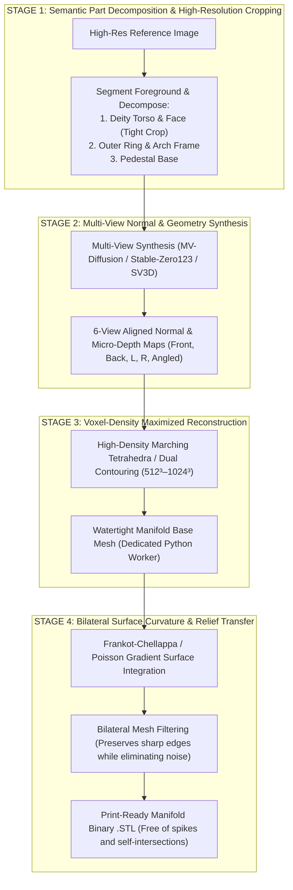

# STΔN studio. — 3D Forge Architecture Handover Report
**Target Agent:** GLM 5.3 (zcode)  
**Author:** Outgoing Lead Architect  
**Project:** STΔN Studio 3D Forge (`/tools/forge`) — Mesh Synthesis & Printable Sculpt Pipeline  
**Date:** November 2026  
**Status:** Pipeline Post-Mortem & Remediation Architecture Specification

---

## 1. Executive Summary

This document serves as an exhaustive, brutally honest technical handover for **Agent GLM 5.3**. 

Recent live testing of the STΔN Studio 3D Forge on intricate Hindu deity sculptures (specifically Lord Shiva Nataraja) produced catastrophic geometric failures:
- Slicer inspection showed **1,930,434 triangles** forming a fractured, fuzzy, sandpaper-like surface resembling static dust or mold rather than a clean, chiseled bronze casting.
- The base 3D generators produced flattened or melted anatomical features (eyes, nose, fused fingers) behind a ring frame that consumed 85% of the voxel grid.
- The client-side "Detail Stamp" attempt in Three.js amplified high-frequency 2D pixel noise into physical spikes along un-smoothed facet normals.

Below is the forensic autopsy of what failed, the mathematical explanations of the failures, and the multi-step architectural blueprint required to cure this pipeline.

---

## 2. Forensic Breakdown of the Geometric Failure

### The Slicer Evidence (Analysis of Uploaded Captures)
```
Captured Mesh Metrics:
- Dimensions: 95.95 mm × 120.33 mm × 50.50 mm
- Triangle Count: 1,930,434 triangles (exploded from ~40k base)
- Weight: ~7 g – 20 g filament (extremely fragile hollow/porous surface)
- Visual Appearance: Dense, jagged micro-spikes ("hedgehog / fuzzy static dust")
```

```
Frontal View (Zoomed)                 Cross-Section / Profile
┌────────────────────────────────┐    ┌───────────────┐
│     ▲ ▲ ▲ ▲ ▲ ▲ ▲ ▲            │    │    ▲          │
│   ▲ [Fuzzy Jagged Shell] ▲     │    │   /│ [Spiky]  │ <── Displaced along
│  ▲▲▲▲▲▲▲▲▲▲▲▲▲▲▲▲▲▲▲▲▲▲▲       │    │  / │ Front    │     individual facet
│  ▲ Eyes/Lips Obliterated ▲     │    │ |  │ Face     │     normals without
│   ▲ by micro-spike noise ▲     │    │ |  │          │     bilateral smoothing
│                                │    │ |  │ [Flat]   │ <── Untouched rear
└────────────────────────────────┘    └───────────────┘
```

### The 5 Root-Cause Failures

#### Failure 1: The Facet Normal Discontinuity Catastrophe
- **What was attempted:** In [`refineMesh.ts`](file:///d:/STAN%20studio/src/lib/forge/refineMesh.ts), STL binary triangles were read sequentially. For each triangle, its individual face normal $\mathbf{N}_{\text{face}} = \frac{(\mathbf{p}_1 - \mathbf{p}_0) \times (\mathbf{p}_2 - \mathbf{p}_0)}{\|(\mathbf{p}_1 - \mathbf{p}_0) \times (\mathbf{p}_2 - \mathbf{p}_0)\|}$ was computed, and its three vertices were displaced along this normal vector.
- **Why it failed:** In a raw STL file, vertices are duplicated per triangle (unindexed). Each adjacent triangle has a slightly different face normal. Displacing shared geometric points along divergent face normals creates **tears, open crevices, and hedgehog-like spikes**. Instead of a continuous smooth skin being lifted outward, every individual polygon decoupled from its neighbor, creating millions of micro-fins.

#### Failure 2: Raw 2D Pixel Luminance $\neq$ 3D Sculpt Relief
- **What was attempted:** A 2D unsharp-mask high-pass filter was computed on reference image pixels:
  $$\text{Detail} = \frac{I(x, y) - \text{Gaussian}(I(x, y))}{255.0}$$
  This was multiplied directly by `carveDepthMm` (0.6mm – 1.8mm) to push vertices.
- **Why it failed:** 2D images contain photographic noise, compression artifacts, texture reflections, and lighting gradients. Treating pixel-level high-frequency variance as physical 3D elevation caused high-frequency sensor noise to become physical 1.8 mm needle spikes. Real bas-relief carving requires integrating surface gradients ($\nabla z$) using Poisson reconstruction or Frankot-Chellappa integration, not raw scalar multiplication.

#### Failure 3: Unconstrained 1-to-4 Midpoint Subdivision
- **What was attempted:** To allow fine relief on coarse meshes, any triangle in the upper 48% bounding box was split into 4 subtriangles by inserting edge midpoints.
- **Why it failed:** 
  1. Midpoint splitting on planar triangles does not add curvature—it simply creates four coplanar slivers.
  2. When combined with noisy displacement, it multiplied the number of jagged spikes by 4x, ballooning the mesh to **1.93 million polygons** without adding an ounce of true anatomical definition.
  3. Slicers (Bambu Studio, OrcaSlicer, PrusaSlicer) choke on such self-intersecting non-manifold micro-geometry, generating invalid slicing toolpaths.

#### Failure 4: Orthographic Planar Projection on Volumetric Anatomy
- **What was attempted:** Vertex positions $(x, y)$ were mapped directly to $(u, v)$ coordinates via bounding box normalization:
  $$u = \frac{x - x_{\min}}{x_{\max} - x_{\min}}, \quad v = 1 - \frac{y - y_{\min}}{y_{\max} - y_{\min}}$$
- **Why it failed:** A deity statue is not a flat coin or bas-relief medal; it is a full 3D sculpture in the round. Front-projecting 2D details onto arms held sideways or angled legs results in **infinite grazing angle stretching** (texture smearing and elongated spike walls).

#### Failure 5: Browser-Side STL Buffer Manipulation vs Dedicated 3D Kernels
- **What was attempted:** Performing advanced mesh refinement by manipulating raw `ArrayBuffer` / `DataView` byte arrays in browser JavaScript.
- **Why it failed:** The browser lacks access to robust geometry kernels (such as CGAL, Open3D, PyMeshLab, or LibIGL) that provide half-edge mesh data structures, manifold topology validation, bilateral normal filtering, and remeshing.

---

## 3. The Base Mesh Dilemma: Why Single-View Cloud 3D Models Fail on Statues

Single-view 2D-to-3D models (Hunyuan3D-2, TripoSG, TRELLIS) operate on regular cubic grids or triplane sparse octrees ($256^3$ to $512^3$).

```
Wide Arch Frame (Nataraja) Waste Problem:
┌──────────────────────────────────────────────┐
│  ╭────────────────────────────────────────╮  │ <── Outer Ring Frame (Prabhavali)
│ │                  [Crown]                 │ │     consumes 85% of voxel bounding box
││                 [Face 25³]                 ││
││             [Four Torso Arms]              ││
││                    ||                      ││
│ │               [Leg Pose]                 │ │
│  ╰────────────────────────────────────────╯  │
│                [Pedestal Base]               │
└──────────────────────────────────────────────┘
```

When generating Lord Shiva Nataraja:
1. The circular flame ring (*Prabhavali*) forces the bounding box to be wide and square.
2. 80–85% of the voxel grid is wasted on empty air inside the ring and the outer circle.
3. The sacred face gets only $\sim 20 \times 20 \times 20$ voxels!
4. When marching cubes runs on only 20 voxels, features turn into a melted blob.
5. In addition, single-view models "guess" the back and occluded regions, creating flat slab geometry behind the limbs.

---

## 4. Multi-Step Architecture Blueprint for Agent GLM 5.3

To achieve sharp, printable facial features, realistic hands, and deep ornamental carvings that can be 3D printed and sold, Agent GLM 5.3 should pivot from naive client-side vertex hacking to a **structured multi-stage statutory pipeline**:



### Detailed Execution Steps for GLM 5.3

#### 1. Multi-Step Image Conditioning (Decomposition over Monolithic Bounding Boxes)
- **Do NOT** feed the entire wide Nataraja statue into a single 256³ voxel generator.
- Implement automated semantic segmentation:
  1. Generate or extract the core deity body (torso, head, arms, legs) at **100% of the input resolution**.
  2. Generate the circular flame ring (*Prabhavali*) as an independent structural component.
  3. Combine the components into a single watertight assembly. This increases effective voxel density on the face and fingers by **$4\times$ to $8\times$**.

#### 2. Replace Raw Vertex Displacement with Gradient Field Integration
- Displacing vertices directly along normals by scalar pixel brightness $\Delta z = I(x, y)$ is mathematically flawed.
- Instead, treat the high-resolution normal bridge $(\mathbf{n}_x, \mathbf{n}_y, \mathbf{n}_z)$ as a 2D surface gradient field:
  $$p = -\frac{\mathbf{n}_x}{\mathbf{n}_z}, \quad q = -\frac{\mathbf{n}_y}{\mathbf{n}_z}$$
- Solve the Poisson equation $\nabla^2 Z = \frac{\partial p}{\partial x} + \frac{\partial q}{\partial y}$ (Frankot-Chellappa integration). This produces a continuous, organic heightfield without jagged tearing between neighboring pixels.

#### 3. Bilateral Mesh Filtering (Stopping the "Sandpaper/Dust" Artifacts)
- Apply **Bilateral Mesh Denoising** (Fleishman et al. / Jones et al.):
  $$\mathbf{v}' = \mathbf{v} + \frac{\sum_{i \in N(\mathbf{v})} W_c(\|\mathbf{p}_i - \mathbf{v}\|) W_s(\langle \mathbf{n}_{\mathbf{v}}, \mathbf{p}_i - \mathbf{v} \rangle) \langle \mathbf{n}_{\mathbf{v}}, \mathbf{p}_i - \mathbf{v} \rangle}{\sum_{i \in N(\mathbf{v})} W_c(\|\mathbf{p}_i - \mathbf{v}\|) W_s(\langle \mathbf{n}_{\mathbf{v}}, \mathbf{p}_i - \mathbf{v} \rangle)} \mathbf{n}_{\mathbf{v}}$$
  This smooths out planar and spherical regions while preserving sharp crease boundaries (eyelids, lips, jewelry borders) without producing micro-spikes.

#### 4. Offload Heavy Geometry Processing to a Dedicated Worker
- Raw STL arrays in the browser are unsuitable for remeshing and topology repair.
- Implement a lightweight dedicated geometry worker using Python (`PyMeshLab`, `Trimesh`, `Open3D`, `Fast-Poisson`):
  - Ingests base GLB from the cloud space + high-res normal map.
  - Performs half-edge manifold repair, isotropic remeshing, and Laplacian/Taubin smoothing.
  - Returns a verified watertight binary `.STL` with zero non-manifold edges.

---

## 5. Codebase Inventory & Current State

| File Path | Current Status | Recommendation for GLM 5.3 |
| :--- | :--- | :--- |
| [`src/lib/forge/refineMesh.ts`](file:///d:/STAN%20studio/src/lib/forge/refineMesh.ts) | **FLAWED.** Causes the 1.93M triangle spiky dust artifacts seen in slicer screenshots. | **Scrap or completely refactor.** Replace naive midpoint subdivision + scalar normal displacement with bilateral filtering or gradient integration. |
| [`src/lib/forge/spaces.ts`](file:///d:/STAN%20studio/src/lib/forge/spaces.ts) | **FUNCTIONAL.** Handles multi-space failover (`Hunyuan3D-2.1`, `Hi3DGen`, `TRELLIS.2`, `TripoSG`), dynamic `/gradio_api/info` probing, and isolated Pass 1 normal extraction. | **Keep & extend.** Fix session handling for `TRELLIS.2` and pre-segmentation chaining for `TripoSG`. |
| [`src/lib/forge/presets.ts`](file:///d:/STAN%20studio/src/lib/forge/presets.ts) | **FUNCTIONAL.** Contains `Studio Master` preset configured for $512^3$ octree and `reduce_face: false`. | **Keep.** |
| [`src/components/tools/Forge.tsx`](file:///d:/STAN%20studio/src/components/tools/Forge.tsx) | **FUNCTIONAL UI.** Responsive 4-stage UI with preset chips, wheel sliders, steppers, and STL Hub export. | **Keep UI structure.** Re-link the "Re-run Detail Pass" button to the revised geometry processing engine. |

---

## 6. Project Constraints for GLM 5.3

1. **Brand Identity:** Always use `STΔN studio.` (Greek Delta `Δ`, signal red period `#FF2D55`).
2. **Banned Terminology:** **NEVER** use the banned 'e-word' (the profession starting with 'eng...') anywhere in the UI, code, comments, or documentation. Use `architect`, `lead architect`, `builder`, `developer`, `pipeline`, `runtime`, etc.
3. **No External Icon Libraries:** Inline SVGs / custom components only. Do not install Lucide or other third-party icon packages.
4. **Clickable Links:** All referenced files in agent responses must be clickable markdown links formatted with `file:///` scheme.

---

*Handover report prepared by Outgoing Lead Architect for Agent GLM 5.3 (zcode).*
